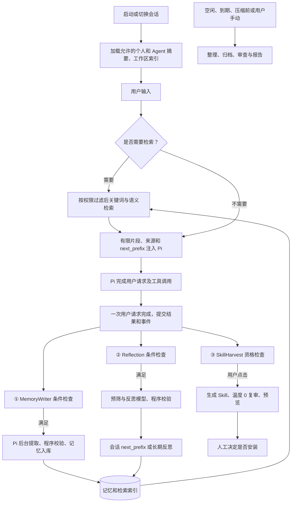

# Accio 记忆与自进化：面向 Pi 的功能迁移审查

## 目标和证据范围

目标是复现用户能感受到的记忆、反思和技能沉淀能力，不复制 Accio 的文件、表结构或代码。允许按需新增 SQLite / PostgreSQL 表、字段和索引；不修改 Pi 自有表的语义，不破坏现有 CRM 及会话数据。本文是设计和审查，**不是已实现功能**。

依据：用户提供的《Accio记忆系统深度解析》；同目录 `accio-memory-map/HANDOFF.md`、`HANDOFF-v4-记忆链路深挖.md` 和 `accio-self-evolution.md`；本机提取的 `C:/tmp/accio/out/main/gateway-worker.js` 局部代码；本项目 Pi Durable 1.4.0 的 `README.md`、SQLite 迁移和 CRM 源码。逆向材料是对某一安装版本的观察，不能外推到所有版本。本次只直接核对了部分片段，不把材料中的推断写成实测事实。

## 上一版遗漏及修正

| 功能 | 本次审查结果 | 功能迁移要求 |
|---|---|---|
| 系统自动采集近期事件 | Pi `entries` 是会话记录；Accio 另有可搜索的消息索引，不能把 Pi 条目直接等同于完整的短期记忆系统。 | 对完成的消息及工具事件建立可重建的受控索引，记录来源和可见范围；不依赖模型主动记忆。 |
| `MemoryWriter` | 检查间隔、内容量、重复触发和主 Agent 本轮已写等条件，另有空闲补写；其工作区卡片与日记/长期记忆不是同一输出。 | 完整保留任务条件、分类、去重、空闲唤醒和结果回读。阈值可配置。 |
| 每轮 Reflection | 轮末尝试判定；还受开关、历史、会话类型、来源 ID 和 funnelGate 等限制。`should_reflect=false` 可不写。 | 独立反思任务，无写入工具；候选由程序校验后按 `next_prefix` 或长期反思保存，记录跳过与失败原因。 |
| `next_prefix` | 是后续请求的会话级前缀，逆向材料显示内存 Map、按会话隔离、默认最多取 3 条；不是自动保存的长期记忆。 | 默认按原功能只在本次运行的对应会话生效；如果产品要重启恢复，必须作为明确的增强并说明差异。 |
| SkillHarvest | 生成前至少检查 5 条历史消息。源码确认存在默认 15 次工具调用的手动阈值配置；材料同时说明阈值到 UI 的完整使用链尚未查到。 | 按用户要求实现：历史消息 ≥5 且有效工具调用 ≥15 时提示，点击后生成候选；过滤及计数由程序执行。不得把材料推测当作原产品实测。 |
| Skill 的第二次复审 | 在提取的 Accio 代码中可见复审调用使用 `temperature: 0`、`maxTokens: 8192` 和 60 秒超时。另一个全局资料修复流程也使用 0，二者不是同一次调用。 | 先生成结构化方案，再用支持 temperature 的模型复审；明确处理模型不支持、超时、无效结果。复审只给意见，不能绕过程序权限和用户确认。 |
| 检索 | v4 描述并在 `gateway-worker.js` 的 `SessionStoreMemoryProvider` 中可见 FTS 与向量两路、RRF 融合；另一份深度解析还描述了本地关键词实现，不能简单等同为单一路径。 | 同时保留关键词和语义检索能力，支持单路失败降级、按需读正文、重建索引；先验证所使用的模型与数据授权。 |
| 启动读回 | Agent 人格/长期记忆、受开关控制的反思、工作区索引和具体技能各有加载时机；已保存不代表已进入模型上下文。 | 固定摘要按预算注入；具体记忆通过搜索和读取工具按需加载；支持回显“使用了哪些记忆”。 |
| 主 Agent 主动写记忆 | 材料描述了轮内按说明选择写长期记忆或日记。原系统使用路径白名单和写入上限。 | 提供受控的记忆提议工具；宿主根据范围、版本和写入规则执行，不给予任意文件权限。 |
| 压缩前保存 | Accio 材料有 50% flush 和 60% compaction 配置，但本地抽取结果未找到 flush 触发调用点；不能说原安装版本已证实执行。 | 功能上设计压缩前检查和提取，实际对接 Pi `beforeCompact` 等机制并以测试验证；阈值按模型上下文动态配置。 |
| 整理 / 做梦 | 材料描述首聊、定时、手动三种入口，近期内容→日记→长期摘要，并有清理、报告；v4 对旧文档中的 150/80 与打分权重标为未证实。 | 实现手动、到期、重启补跑入口和可查看报告；用来源、版本、复核和状态保证失败不删源数据。不要把未证实数字当必选。 |
| 画像和全局同步 | Accio 的 `PROFILE.md`、资产事实、详情、manifest/revision、云端 sidecar 与主 Agent 权限限制是独立能力；不等同于本地 Agent 偏好。 | 个人、Agent、工作区、企业共享分别明确；跨设备及共享需要服务端授权、同步、冲突解决，Pi 本地 SQLite 不自动提供。 |
| 知识库 | v4 的 `asset` RAG/Wiki 检索与 Agent 记忆检索分开；CRM 当前 RAG 预设仍是提示和演示。 | 保留两个入口与权限，不把记忆检索当成已接入知识库。真实知识库需连接器和授权。 |
| 容量/索引修复与导入 | Accio 有索引维护、容量审查、快照/revision 和旧格式修复。 | 设计版本化导入、去重、可预览、断点续跑、索引重建、版本冲突和可撤回；不自动删除原始 Accio 文件。 |

## 功能总流程

“每轮”在材料中需映射到具体事件。Pi README 中 `turn` 是一次模型响应及其工具调用，`run` 是一次用户输入直到最终回答，可能包含多个 turn。**默认按一次用户请求的最终结果提交后检查三条线**，工具计数按实际工具调用 ID 计算；若将来要逐模型轮检查，必须另设事件和去重键，不能混用。Pi 恢复/分支时需要区分原会话的 run 和重跑分支，避免后台任务自行再触发自身。

## 目标模块与数据归属

1. Pi Runtime：保存对话、工具条目、任务与文档；创建持久后台任务和会话分支，提供请求前上下文接口。现有 `evolve()` 是提示词改写、一次无工具分支重跑和文本比较，**不是** SkillHarvest 或完整 Harness 迭代。
2. 轮末协调器：基于已提交的 run ID/entry ID 判定三条线，去重、限流、任务恢复；不把 UI 点击当成状态真相。
3. 记忆库：负责按范围写入、查询、版本、来源、撤销和审计；模型只提交候选，不直接修改底层表或授权范围。
4. 检索：过滤授权范围后检索；关键词和向量可并行，合并排序后再回源授权检查。索引是可重建派生数据，向量来源、模型版本、维度必须记录；嵌入失败可关键词降级，不得宣称等价语义召回。
5. 反思：先廉价条件和可配置预筛，再由模型给是否保留、内容及目标；`next_prefix` 和跨会话教训独立存取。
6. Skill 沉淀：历史快照→生成决策→独立复审→程序校验和 dry run→用户预览与确认→版本化发布；销毁/替换、回滚及外部副作用仍遵守已有权限和确认规则。
7. 整理器：以批次快照、源版本和结果审查完成近期→日汇总→长期摘要；失败或不确定时保留原始材料。关闭桌面进程时任务不能运行，只能在启动后补跑；持久任务不意味着系统关机也会自动工作。
8. 管理 UI：查看和搜索记忆、来源、编辑/禁用/删除、冲突、任务状态、开关与成本；显示自动使用的记忆。Skill 候选展示变化与复审意见，用户确认后才生效。

## 存储设计：允许增表后的推荐方案

第一版保持本地优先：Pi 的会话与任务使用其已有 SQLite 表；记忆采用同一用户作用域下的**宿主自有表**，表名加 `memory_` 前缀，并可在同一 SQLite 文件内通过共享数据库适配器执行。实际实施需将现有 `openNodeSqliteStorage()` 改为在 Worker 中构造一个共享 `openNodeSqliteDatabase()` 并交给 `SqliteStorage.open()`；先验证版本兼容、队列和备份。不得更改现有 Pi 表名或为已有库突然加 prefix。也可用独立的记忆 SQLite 文件，但跨两个库的 Pi 任务完成与记忆写入不能声称天然同事务。

推荐的逻辑表及索引（字段示意，非已创建表）：

| 表 / 索引 | 必要用途和字段 |
|---|---|
| `memory_items` | `id`、`scope_type`、`tenant_id`、`user_id`、`agent_id`、`workspace_id`、`kind`、`title`、`content`、`state`、`version`、时间、可见性；明确 personal/agent/workspace，企业共享由服务端授权。 |
| `memory_sources` | `memory_id`、来源存储标识、`conversation_id`、`entry_id`、来源类型和范围；支持多条来源，不把模型自行写出的来源 ID 当成已验证。 |
| `memory_turn_state` | 可信 `conversation_id` / `run_id` / 最新处理 entry、三条分支状态、累计工具调用和到期时间；对事件去重设置唯一键。 |
| `memory_jobs` 或 Pi 任务文档 | 若 Pi 任务已经足够，避免额外重复任务表；若需跨进程查询报告，可建立投影视图/表，明确 Pi 任务是生命周期的权威来源。 |
| `memory_changes` | 版本变化、用户确认、导入与撤销记录；记录摘要和关联，不记录密钥。是否保留历史正文需符合真正删除策略。 |
| `memory_chunks` + FTS5 | 保存记忆分块、原记忆 ID/版本/位置及可重建全文索引；版本变化后同步更新。中文 tokenizer 要实测，FTS 能被检索不代表能跨语言语义匹配。 |
| 向量索引 | 存分块 ID、embedding 模型和版本、维度和向量；可选 `sqlite-vec` 需单独验证 Windows/Electron 加载和加密数据库兼容性。维度不能硬编码照抄 1536。 |
| `skill_candidates` / `skill_versions` | 来源会话和条目、生成/复审结果、diff、状态、版本、用户确认、激活和回滚记录；独立于 CRM 业务资料。 |

索引建议：按 `(tenant_id, user_id, agent_id, scope_type, state)` 做授权范围过滤；记忆来源按 `(conversation_id, entry_id)`；轮末任务按 `(conversation_id, run_id, kind)` 做唯一约束；候选按状态和创建时间查询。范围字段采用逻辑唯一键和明确的非空/CHECK 规则，避免 SQL NULL 导致唯一约束漏判；具体约束须与 SQLite/服务端权限设计共同验证。

**一致性**：不要在 Pi 事务回调里调用共享数据库外部连接，避免队列死锁。Pi 已提交条目是源；协调器持久化处理游标并按稳定 ID 重放。宿主记忆写入、来源记录、索引更新及其幂等键在宿主事务中提交；Pi 任务状态和宿主事务之间的崩溃窗口由重启对账与幂等补偿处理，不声称跨接口自动原子。外部模型调用可能被重试、产生额外费用，不能承诺只调用一次；仅保证可验证的落库效果不重复。

## 隔离、保密、同步与撤销

- 当前主进程用 `api.origin:tenant:user` 派生本机目录；Pi `session` 文档范围只覆盖当前数据库，不等于跨设备/跨企业的账号全局。登录、切换租户、成员停用、离线和权限撤销后，检索、读原文、注入、重试及后台任务都需重新校验。CRM 客户事实的访问仍走 FastAPI；禁止把无权客户资料因记忆命中泄露给用户或模型。
- 当前选择企业可能设置临时模式，文件模式使用 `conversations.sqlite`；常规 Node SQLite 文件本身未加密。Electron `safeStorage` 可保护密钥，但不会自动加密 SQLite、FTS、向量、WAL、临时文件或备份。要实现安全持久化，需要验证支持加密的 SQLite 适配器、密钥保护与备份/恢复；不能将加密包当作已安装或已验证。若不能获得可用加密能力，自动长期存储应保持关闭并说明。
- 私有记忆与企业共享记忆的来源、查询和同步分开；只要要求跨设备/跨员工，就要服务端 API、成员权限、同步游标、冲突/撤销协议及服务端数据模型，不能宣称 Pi 的本地 session 自动同步。具体共享范围和保留策略依赖用户/企业的业务设置。
- 删除至少要处理记忆正文、chunks、FTS、向量、缓存、已注入下次上下文、源数据衍生项及可同步副本。Pi 不可变 entries / document revisions、SQLite WAL、已有备份与合法审计中的内容可能继续存在，须单独规定数据保留、轮换和真正擦除流程；不因标记删除就声称物理擦除。
- 模型/embedding 调用可能将对话或客户信息发送至外部服务；工具返回内容和记忆文本均当作不可信数据，不能升级为系统指令或修改权限。默认记录必要的状态和来源，避免日志落密钥或完整敏感内容。

## 与 Accio 默认值和功能等价的关系

- 10 轮 MemoryWriter、历史 ≥5 条、手动提示 15 次调用、2 小时待处理、反思 ≤700 字、前缀最多 3 条、近期反思最多 30 条，均可作为迁移的可配置起始值，不当作性能或准确率保证。
- 反思启用、自动/手动 Skill 模式、调用次数计数口径、原始 vs 汇总保留期限要在实现中明确。原 Accio 自动反思读回开关材料显示默认关闭；产品是否默认打开属于迁移配置，不应宣称是已核实的原行为。
- 资料中同时出现旧关键词检索和新 FTS+向量检索，版本与安装配置不同可能触发不同实现；功能迁移采用可降级双路，不能说已完整还原所有线上路径。
- 手动阈值 15 在配置与传递处可见，材料明确 UI 使用点未完全证实；按用户明确要求实现该规则。50% flush 的本地调用点亦未确认。日记评分 150/80 和权重被 v4 标为未证实。
- 复审 `temperature=0`、前置至少 5 条消息、检索端 RRF、Pi `defineDoc` 和数据库物理表，本次已分别对已抽取源码或本地 Pi 1.4.0 文件做只读核对。模型的判断仍不是质量证明。

## 建议落地次序与验收

1. **会话与隐私底座**：确定临时/持久模式、单 Worker 持库、备份与加密；在副本上迁移验证，原数据库和 CRM PostgreSQL 不重置。
2. **记忆模型与读回**：实现范围、来源、记忆 CRUD、摘要注入、FTS；验证跨租户/成员权限、撤销、真正删除边界。
3. **三路轮末协调**：定义完整 run 事件，可靠去重、并发排队、重启对账；分别接 MemoryWriter、反思、Skill 资格提示。
4. **反思和 Skill**：实现 `next_prefix` / 长期教训、生成→温度 0 复审→程序检查→用户确认→版本发布；验证失败、并发、过期快照和回滚。
5. **整理与检索增强**：近期→日汇总→长期摘要、空闲/压缩前/手动入口及恢复报告；加向量和双路融合、FTS 回退，基于目标机器测耗时和内存。
6. **导入与同步**：旧 Accio 数据只读扫描→预览→幂等导入→复核；跨设备共享另用服务端授权和同步，先做评审和兼容迁移。

核心验收：三路判定的触发/跳过；真实来源条目与工具调用计数；人工纠正、相互矛盾和跨用户隔离；反思不会升格为系统权限；next_prefix 隔会话及恢复语义；≥5/≥15 提示但无点击不生成；温度参数不支持时可见失败；模型超时/截断输出不提交；多次重试仅一次落库；索引重建和权限撤销；关机后任务恢复、备份恢复和加密验证。前端遵循既有要求，只做逻辑及自动测试，不主动点击用户页面。需用模拟模型完成自动化，再另行标识真实模型/embedding/云同步是否实际验收。
