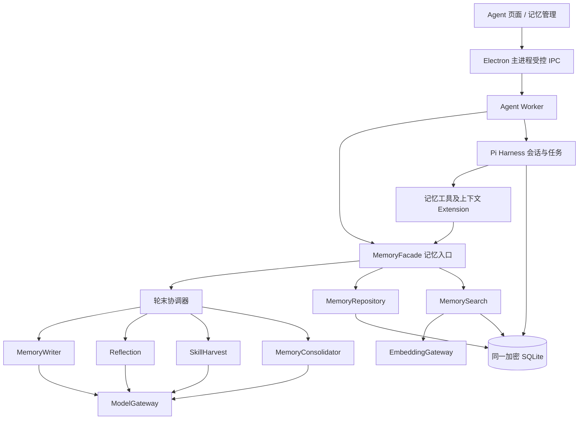

# Pi 记忆系统功能迁移：实施设计

> 本文件保留设计时的背景和候选结构，部分“现有项目”描述已过时。实际实现、测试和未完成部分以 [Agent 集成状态](agent-integration-status.md) 为准。

## 目标与当前选择

以功能方式实现 Accio 的近期记忆、工作区记忆、反思、Skill 沉淀和后台整理，运行和生命周期由 Pi 管理。第一版是**本机个人记忆**：同一服务地址、企业、用户在本机的多个会话共享；不同企业或用户分开。检索采用本地关键词 + 可配置的远程语义检索，远程不可用时降级。当前不做跨设备同步或企业共享，不导入 Accio 实际内容，保留后续导入的接口。

现有项目无完整记忆模块。`runtime.mjs` 的 `ChatIndex` 保存会话列表；Pi `entries` 保存对话条目，`tasks` 保存运行；`evolve` 目前只是一次提示词改写、无工具分支重跑及文本比较。它不等同 SkillHarvest，也没有完整 Harness 迭代。实施不覆盖或替换现有 CRM 权限与审批。

## 模块划分和依赖

- `MemoryFacade` 对外集中提供 `onRunCompleted(runRef)`、`prepareContext(conversationId, requestId)`、`search(query, scope)`、`get(id)`、`propose(input)`、`review(candidateId, decision)`、`manage(command)`；内部组合模块，不允许 UI、Pi Extension 直接写表。
- `MemoryRepository` 管理数据、来源、乐观锁、索引变更和作用域；`MemorySearch` 只接受可读范围，并返回正文来源 ID 与当前版本；模型通过 `ModelGateway`/`EmbeddingGateway` 接口调用，可用模拟适配器测试。
- `TurnCoordinator` 负责真实用户 run 的去重、调度和恢复。三个处理器只产生候选和结果；共同的程序校验、授权、保存由记忆模块执行。后台处理器不触发自己的轮末处理。
- Pi 的 `section`/工具提供 `memory_search`、`memory_get`、`memory_propose`，请求前注入短摘要及本会话的 `next_prefix`；正文、工具结果和记忆均视为不可信数据，不能覆写系统权限。三方调用必须携带宿主确定的用户及租户范围，不接受模型提交身份或权限。
- Harness 轨迹比较、SkillHarvest 和普通反思保持三个模块。它们可以调用共同的来源/候选接口，但不会互相修改运行状态。聊天中的重跑需要独立继续完成 Pi 基线、候选轨迹和 AI 比较；没有可回放的工具轨迹时明确不可比较，不能显示为通过。

## 数据结构和迁移

Pi 自有 `conversations`、`entries`、`tasks`、`submissions`、`documents`、`document_revisions` 不改名、不手工插入。Pi 与记忆表共用一个 Worker 持有的加密 SQLite 连接和同一个操作队列；不在 Pi 事务回调内调用队列外部操作。将现有 `openNodeSqliteStorage` 替换为可共享数据库适配器；保留 Pi 自有表原前缀和 schema 历史。

采用 Windows/Electron 兼容的 `better-sqlite3-multiple-ciphers`，固定经构建验证的版本，选择 SQLCipher 兼容加密；Worker 通过实现 Pi `SqliteDatabase` 异步队列接口的适配器访问该连接。主进程按 `origin + tenant + user` 生成随机数据库密钥，用 Electron `safeStorage` 保管，仅通过受控进程通道传给 Worker，不放 renderer、命令行、环境变量或日志。SQLite 连接先设置加密再访问；密钥不可用、驱动不可用或验证失败时显示错误并允许临时会话，不落明文新记忆。实际 Electron 43 Windows x64、打包、FTS、Pi 存储规范和 WAL 加密需用测试确认；不能因依赖声明而称已验证。

宿主以版本化迁移创建以下表（SQLite 外键打开，时间统一 UTC，ID 为 UUID 字符串；Pi entry / submission ID 作为文本保存，不能假定跨数据库全局唯一）：

| 表 | 主要字段与约束 |
|---|---|
| `memory_items` | `id` 主键；`scope_type`（`personal/agent/workspace`）、`tenant_id`、`user_id`、`agent_id`、`workspace_id`；`kind`（`feedback/project/reference/diary/long_term/reflection`）；`title`、`content`、`status`（`active/pending/superseded/deleted`）、`version`、`created_at`、`updated_at`。不同 scope 的必要字段以 CHECK 校验；`version` 更新时比较并递增。 |
| `memory_sources` | `id`、`memory_id`、`conversation_id`、`submission_id`、`entry_id`、`source_kind`、`source_version`；对同一记忆和来源去重；只记录已核实属于当前 scope 的条目。 |
| `memory_turn_state` | `conversation_id`、`submission_id` 组成唯一键；`last_entry_id`、`tool_call_count`、writer/reflection/harvest 状态、`created_at`、`updated_at`；每个 run 不因崩溃或重连重复产生工作。 |
| `memory_task_runs` | `id`、`pi_task_id`、`kind`、`conversation_id`、`submission_id`、`status`、`stage`、`attempt`、`error_code`、起止时间；作为 Pi task 可查询投影，不取代 Pi 的任务状态。 |
| `memory_changes` | `id`、`memory_id`、`old_version`、`new_version`、`action`、`actor_type`、`source_task_id`、时间；避免在日志和审计投影保存完整客户正文和密钥。 |
| `memory_chunks` + FTS5 | `id`、`memory_id`、`memory_version`、`chunk_no`、`content`；同版本块序号唯一；全文索引保存同样的 row ID，随正文事务更新，允许重建。 |
| `memory_embeddings` | `chunk_id`、`memory_version`、`model`、`dimensions`、`vector`、`status`、`updated_at`；来源删除或版本变化后失效；同一块与模型版本唯一。 |
| `skill_candidates` | `id`、来源 `conversation_id/submission_id`、生成决策与内容、复审意见、`review_model`、`review_temperature`、`status`、`created_at/expires_at`、`base_version`；过期或基线变化不能直接发布。 |
| `skill_versions` | `skill_id`、`version`、`content`、`content_hash`、`status`、`source_candidate_id`、`approved_by`、时间；同一技能只有一个激活版本，支持回滚。 |

索引：`memory_items(scope_type, tenant_id, user_id, agent_id, workspace_id, status)`；`memory_sources(conversation_id, entry_id)`；`memory_task_runs(conversation_id, submission_id, kind)` 唯一；`skill_candidates(status, expires_at)`；全文索引按权限过滤后读取正文。为可空作用域字段采用 CHECK 与分范围部分唯一索引，不依赖 SQLite 对 NULL 的唯一性。

旧 `conversations.sqlite` 若存在：先安全停止持有它的 Worker，使用 SQLite 备份读取包含 WAL 的一致快照；对备份副本建立新加密库，再校验完整性、会话数量/ID、历史和任务恢复，成功后切换新库。原文件及其关联日志保留，不自动删除。加密库失败则原文件保持可恢复，不自动以明文继续长期记忆；已有 `session.sqlite` 单独识别并列出，不假装自动合并历史。迁移器和宿主表各有独立版本，不覆盖 Pi 的 schema 版本。

## Pi 嵌入与三条判断

### 请求前与请求完成

`runtime` 启动时安装 memory extension 和任务定义；主会话提交前按已认证 scope 调用 `prepareContext`，将有限摘要、有效反思和本会话 next_prefix 注入请求，记录所用记忆 ID 和版本。`beforeRequest` 在重试时可能多次执行，按请求 ID 复用同一快照，避免重复写入或记忆版本漂移。

`submission.wait` 返回正常完成且 Pi 已提交最终条目后，协调器用真实 `conversation_id + submission_id` 发起一次检查。Pi 内每个模型 turn 可有多个工具调用，用户的一次 run 可有多个 turn；统计已经实际开始的主会话工具调用，以 call ID 去重，失败算一次；排除内部记忆/复审任务和未实际执行的拒绝调用。进程中断时从已提交的 Pi submissions / entries 重新对账，去重键保证候选不重复；模型可能重试收费，不能保证模型只调用一次。

### ① MemoryWriter

默认每 10 个完成的用户 run 检查一次，`minContentLength=100`、最多读取最近 100 条消息；用户明确要求记住时立即安排，允许“无需要保存的内容”。同轮主 Agent 已保存同主题时只更新一次。用户空闲 10 分钟且自上次处理至少 8 个 run 时补写；应用关闭后在下次启动补跑。模型输出事实候选、分类、可核对的来源条目，程序检查来源、权限、长度和相似主题；不合法、截断、失败结果不写。冲突转为 pending，用户确认或纠正；完成后推进水位。

### ② Reflection

每个 run 完成检查开关、对话和来源，预筛通过后调用无写入工具的反思模型。模型输出 `should_reflect`、最多一条 `experience` 和 `destination`；程序限制长度不超过 700 字符，验证来源与范围。`next_prefix` 放当前 Worker 的会话内存，最多取 3 条，重启后丢弃以保持原功能；`agent_memory` 保存到 `memory_items(kind=reflection)`，默认只注入最新 30 条中的相关内容。反思默认开启；个人隐私设置可以关闭生成和读取，二者分开设置。模型失败不伪造教训，不阻塞主对话。

### ③ SkillHarvest

同一会话历史消息 ≥5 且去重工具调用 ≥15 时，生成有效期 2 小时的提示；每增加 15 次工具调用可再次提醒。用户点击才运行，不自动安装。Pi 子任务基于受限的消息和工具轨迹快照先生成 `skip/create/patch/replace/delete` 结构化候选，再调用支持温度参数的复审模型，`temperature=0`、最多 8192 token、60 秒超时。默认只提供 `skip/create`，已有技能的修改/替换/删除经用户预览后启用；模型不执行 shell、文件写或网络副作用。模型不支持温度、超时、返回不完整或 JSON 无效时标记未完成，可重试，不能当成通过。

候选生成和复审之后，程序校验结构、长度、身份范围、工具白名单和基线版本，生成 diff 及 dry run；用户确认后记录可回滚版本。Skill 正文作为受控 Pi extension 的可调用指导/资源加载，不能增加新工具或权限；如导出 Markdown，由宿主只写专用用户目录，数据库版本为权威、导出失败可重试，不允许任意路径覆盖。回滚更新激活版本，下一次请求才生效。

### 检索、整理和压缩

本地 FTS5 分块检索与远程 embedding 并行；远程默认使用可配置 OpenAI `text-embedding-3-small`，不写入秘钥。设置页明确提示内容会发送第三方并允许关闭；无凭据或失败时使用关键词并显示已降级。保存模型版本和向量维度，修改模型后后台重建；按授权范围过滤后评分，返回片段时再次检查权限。RRF 只是排序，不代表记忆正确。大型索引需要性能测试；若 SQLite 向量插件无法在 Electron 安装或加密库加载，首版使用分批扫描本地向量并报告性能，不引入 Redis。

每天及用户手动启动整理近期记录，产生 `diary` 与 `long_term` 候选；先校验、保存、核对来源和版本，再标记可归档。失败不删除来源；不照搬未经证实的淘汰数量。Pi `beforeCompact` 的 API 只能读取并返回决策，不能当作直接写入工具；在请求前监测上下文水位安排提取，遇到内部自动压缩时依赖已保存的 Pi 条目并补偿，明确显示提取是否完成，不能声称所有场景都压缩前写入。

## UI、错误和验收

- Agent 页面保留一屏聊天；历史对话可重启恢复，左侧技能选择，右上设置/记忆管理可展开。每条回复提供自进化入口；Skill 资格提示显示消息/调用数量、到期时间及“生成候选”，点击后显示 Pi 真实阶段、错误、重试及复审，最终原始/候选和 AI 意见都展示给人。不会自动执行外部动作或发布技能。
- 记忆管理提供范围、来源、版本、启停、修改、删除、冲突和后台任务状态；记录用了哪些记忆。归档、删除索引与缓存；Pi 历史、备份和已有明文文件不是自动彻底擦除，需要单独治理并明确提示。
- 单元和集成测试：身份及 scope 隔离；重启保存和临时模式；重复事件、断电恢复、失败重试、版本冲突；15 次工具阈值和 5 条消息；反思不自触发、next_prefix 跨会话隔离；复审温度和不支持错误；未经确认不发布；FTS/向量降级与授权；整理失败不删源；旧库迁移备份、错误密钥、WAL、真实 Electron 驱动；聊天分支不会执行真实写操作。
- 验收须区分模拟模型和真实模型/embedding；未配置密钥时展示不可用并测试错误路径。运行 `npm test`、`npm run build`、Pi 存储适配器规范测试及真实 Electron utility process 测试。按用户要求不自动点击前端页面。

## 参考

- Pi 1.4.0 本地 README 的 `Your Own State`、`Hooks`、`Storage`；项目 `client/agent/runtime.mjs` 与 `client/electron/main.cjs`。
- OpenAI embedding：https://developers.openai.com/api/docs/guides/embeddings
- Electron safeStorage：https://www.electronjs.org/docs/latest/api/safe-storage
- SQLite3 Multiple Ciphers：https://utelle.github.io/SQLite3MultipleCiphers/docs/configuration/config_sql_pragmas/
- better-sqlite3-multiple-ciphers：https://github.com/m4heshd/better-sqlite3-multiple-ciphers/releases
