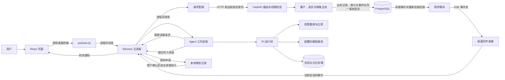
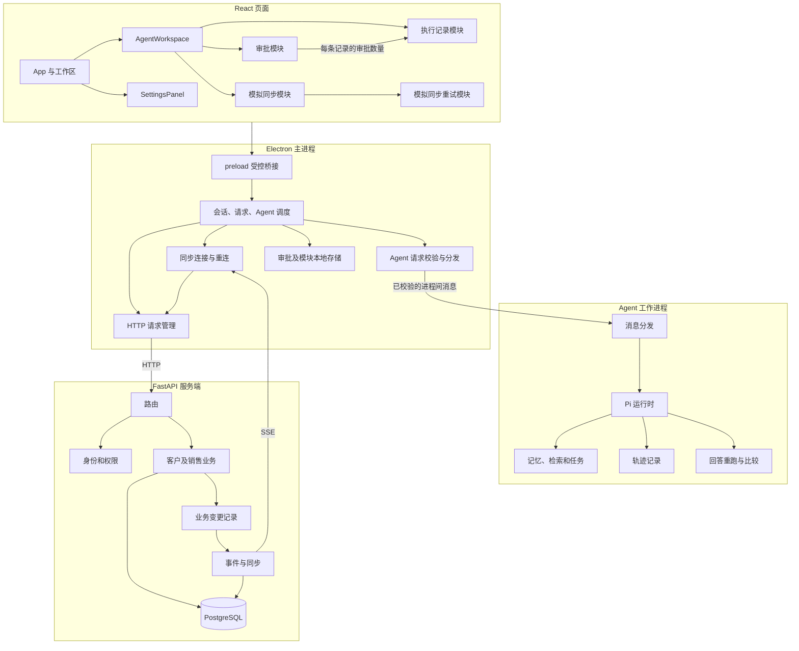

# CRM 主要数据流、模块和耦合点

本文依据当前代码描述主要路径，不覆盖所有异常分支。图中的线表示调用或数据传递，不表示所有组件在同一进程运行。

## 业务和 Agent 数据流

- 一般业务请求从 `src/api.ts` 经 `preload.cjs` 到主进程，再由主进程请求服务端。服务端的 `service.write` 负责幂等处理和提交；成功的业务变更通过 `outbox.emit` 加入同步事件。
- 同步模块读取事件时重新检查当前账号的访问权限。SSE 是服务端向客户端持续发送事件的连接；客户端收到通知后合并或重新读取数据。
- Agent 对 CRM 的读取经主进程限制路径。受支持的写操作先创建审批，用户确认后才由主进程请求服务端。模型和 Agent 不直接写 CRM 数据库。
- 默认会话使用本机加密存储；临时会话不持久保存。模拟同步和演示检索不是第三方真实接入。

## 主要模块关系

## 这次重构解决的耦合

原来的 `App.tsx` 同时放置业务入口、Agent 整页、系统设置、审批、执行记录和模拟同步。Agent 组件还同时持有审批列表、模拟任务和对话状态。修改模拟同步时，需要在同一个组件中检查审批和对话的状态及初始化过程。

这次将 Agent 页面和系统设置移出应用入口。Agent 请求的参数校验与分发也从 Electron 主进程移入独立模块；主进程仍负责验证发送者、登录身份和进程生命周期。Agent 审批模块负责列表、确认、刷新和展示；执行记录模块只接收每条记录的关联审批数量；模拟同步模块负责自己的状态和重试。模拟同步重试模块按目标保留未确定结果的操作标识，成功后再清除。审批控制器只发布当前页面和最新刷新请求的结果，防止较旧请求覆盖较新结果，或页面关闭后更新新会话。

Agent 页面仍把忙碌状态和错误提示传给这些模块，以保持页面原有的操作协调方式。模型、审批执行、授权和服务端事务的实现没有因此迁移到前端。

继续重构时，`crm-transport.cjs` 负责 HTTP 地址校验、请求取消和重试标识；账号状态和权限失效后的清理仍由主进程协调。同步连接、游标、断线重连和停止逻辑集中到 `sync-stream.cjs`。每条连接持有启动时的身份，旧连接停止后不会再发送事件或撤销新会话；分块接收时会正确处理跨块的 CRLF 和 UTF-8 字符。

`evolution-runner.mjs` 负责一次回答的安全重跑与比较；`runtime.mjs` 继续负责运行时组装、任务注册和会话存储。恢复任务在执行前仍等待运行时绑定，来源权限仍在原有阶段复核。

`change_journal.py` 统一成功操作的审计与同步事件写入。它使用调用方传入的数据库会话，不自行提交。客户和成员审计仍不记录字段新旧值，销售审计仍按原规则记录变更值；同步事件只记录字段的新值，向客户端下发时还会筛选允许的字段。

## 后续可继续处理的耦合

- `electron/main.cjs` 仍同时负责登录会话、Agent 进程和审批。它们共享账号生命周期与清理顺序，后续拆分应继续验证切换账号和进程退出。
- `agent/runtime.mjs` 仍负责会话初始化、对话、记忆和轨迹组装；继续拆分时必须保留数据库单进程所有权和恢复顺序。
- `app/service.py` 和 `app/sales_service.py` 仍共享部分权限查询与业务关联校验；应按实际业务规则拆分，避免只增加转发层。

上述位置仍可继续改进，不能只凭文件数量判断是否已经消除耦合。
