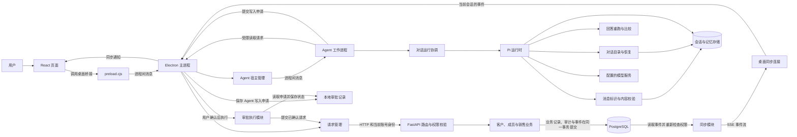
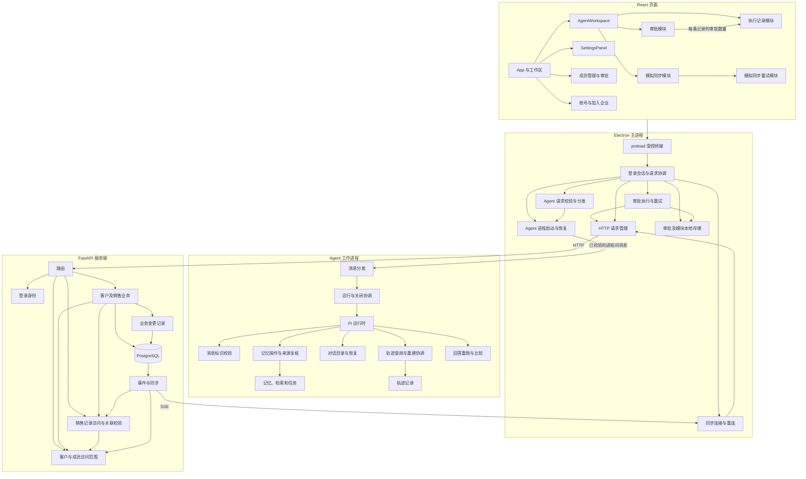

# CRM 主要数据流、模块和耦合点

本文依据当前代码描述主要路径，不覆盖所有异常分支。图中的线表示调用或数据传递，不表示所有组件在同一进程运行。

## 业务和 Agent 数据流

- 一般业务请求从 `src/api.ts` 经 `preload.cjs` 到主进程，再由主进程请求服务端。服务端的 `service.write` 负责幂等处理和提交；成功的业务变更通过 `outbox.emit` 加入同步事件。
- 同步模块读取事件时重新检查当前账号的访问权限。SSE 是服务端向客户端持续发送事件的连接；客户端收到通知后合并或重新读取数据。
- Agent 对 CRM 的读取经主进程限制路径。受支持的写操作先创建审批，用户确认后才由主进程请求服务端。模型和 Agent 不直接写 CRM 数据库。
- 默认会话使用本机加密存储；临时会话不持久保存。模拟同步和演示检索不是第三方真实接入。

## 主要模块关系

## 这次重构解决的耦合

原来的 `App.tsx` 同时放置业务入口、Agent 整页、系统设置、审批、执行记录和模拟同步。Agent 组件还同时持有审批列表、模拟任务和对话状态。修改模拟同步时，需要在同一个组件中检查审批和对话的状态及初始化过程。

这次将 Agent 页面和系统设置移出应用入口。Agent 请求的参数校验与分发也从 Electron 主进程移入独立模块；主进程仍负责验证发送者、登录身份和进程生命周期。Agent 审批模块负责列表、确认、刷新和展示；执行记录模块只接收每条记录的关联审批数量；模拟同步模块负责自己的状态和重试。模拟同步重试模块按目标保留未确定结果的操作标识，成功后再清除。审批控制器只发布当前页面和最新刷新请求的结果，防止较旧请求覆盖较新结果，或页面关闭后更新新会话。

Agent 页面仍把忙碌状态和错误提示传给这些模块，以保持页面原有的操作协调方式。模型、审批执行、授权和服务端事务的实现没有因此迁移到前端。

继续重构时，`crm-transport.cjs` 负责 HTTP 地址校验、请求取消和重试标识；账号状态和权限失效后的清理仍由主进程协调。同步连接、游标、断线重连和停止逻辑集中到 `sync-stream.cjs`。每条连接持有启动时的身份，旧连接停止后不会再发送事件或撤销新会话；分块接收时会正确处理跨块的 CRLF 和 UTF-8 字符。

`evolution-runner.mjs` 负责一次回答的安全重跑与比较；`runtime.mjs` 继续负责运行时组装、任务注册和会话存储。恢复任务在执行前仍等待运行时绑定，来源权限仍在原有阶段复核。

`change_journal.py` 统一成功操作的审计与同步事件写入。它使用调用方传入的数据库会话，不自行提交。客户和成员审计仍不记录字段新旧值，销售审计仍按原规则记录变更值；同步事件只记录字段的新值，向客户端下发时还会筛选允许的字段。

## 继续重构后的职责

- 成员管理与成员审批集中在 `MemberManagement.tsx`；账号设置与加入企业表单集中在 `Account.tsx`。应用入口负责选择页面和传入当前账号，不再包含这些页面的具体请求与表单状态。
- `approval-executor.cjs` 集中处理审批提交、并发限制、状态变更和不确定结果的重试。主进程仍负责校验消息发送者、提供当前账号和协调会话清理。切换会话后，旧提交不会更新新会话的审批结果。
- `conversations.mjs` 管理对话目录、恢复、切换和标题保存。它使用运行时传入的 Pi harness；会话与记忆仍由同一工作进程管理同一个数据库。`runtime.mjs` 保留模型、记忆、任务和轨迹的组装；`memory/facade.mjs` 收拢记忆操作，`trace-facade.mjs` 收拢轨迹查询与重建，稳定的消息标识由 `chat-requests.mjs` 校验并交给 Pi 去重。
- `access.py` 集中客户、联系人和成员访问范围；`sales_access.py` 集中销售记录的权限查询与关联校验。客户业务、销售业务、路由和同步模块调用这些检查，原有的加锁、事务和权限规则保持不变。

## 仍需关注的边界

- `electron/main.cjs` 仍协调登录会话，`agent-host.cjs` 负责 Agent 工作进程启动、停止和恢复；两者共同维持账号切换及旧进程退出顺序。
- `agent/runtime.mjs` 仍负责模型、记忆、任务和轨迹的组装；`run-coordinator.mjs` 管理一次聊天及关闭收尾。继续调整时必须保持数据库的单进程所有权、任务恢复顺序和来源权限复核。
- `App.tsx` 中的业务列表仍根据不同实体处理筛选、分页和商机阶段变更。后续若这些行为继续增长，可以按业务页面进一步拆分；目前不能仅凭文件大小认定已经出现故障。
- 销售记录读取和关联校验仍会互相调用，以检查相关记录的权限和一致性。修改这些规则时应同时验证跨企业、负责人范围及关联对象属于同一客户的约束。

模块之间仍有必要的依赖；判断是否还需调整，应看修改时是否需要同时理解或修改无关职责，而不是以文件数量为标准。
