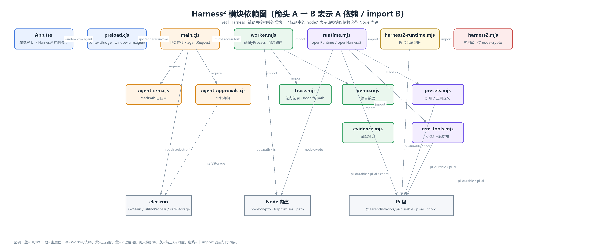
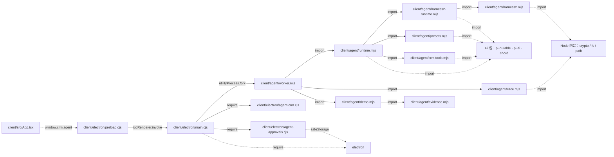
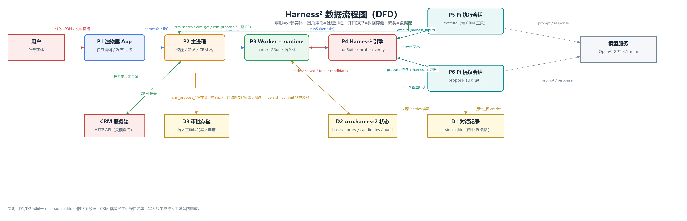
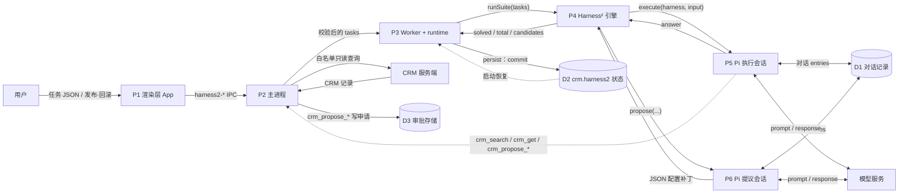
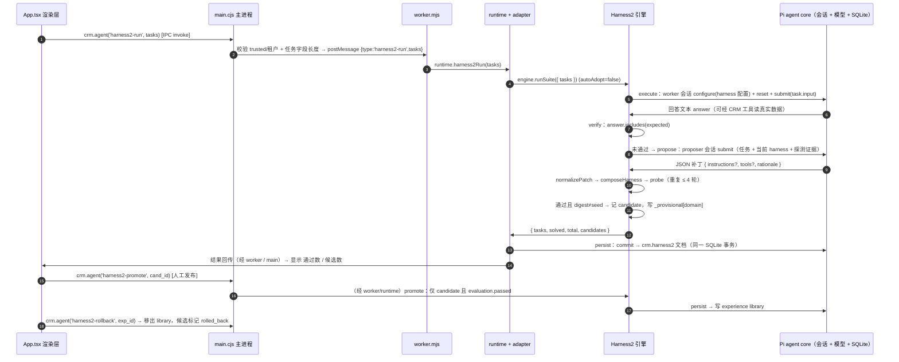

# Harness² 架构：模块依赖图与数据流程图

> 新能力以 **Harness²（Recurse Agent Harnessing）** 为准；自建 Skill 自演进代码已删除。
> 本文给出两张图：**模块依赖图**（文件/模块之间真实的 import / require 关系）与**数据流程图 DFD**（外部实体、处理过程、数据存储与数据流）。
> 配套图片：`docs/harness2-module-dependency.png`、`docs/harness2-data-flow.png`；实现细节见 `docs/harness2-implementation.md`。

## 1. 模块依赖图

> 箭头方向为 **A → B：A 依赖 / import B**。实线为 import/require，虚线为运行时桥接（IPC、窗口全局、safeStorage 等）。

**分层要点**

- **渲染层**只发 IPC 动作（`harness2-state/history/run/promote/rollback`），不接触模型与数据库。
- **主进程**负责发送者/会话/租户校验与动作白名单，`harness2-run` 任务数 1..10、字段长度受限，超时放宽到 600s。
- **Worker** 是 utilityProcess 子进程，把消息转发给 `runtime.harness2*`。
- **运行时装配** 先 `Harness.open(session.sqlite)` 打开 Pi agent core 与会话，再把同一个 harness 注入 `openHarness2`。
- **适配器** `harness2-runtime.mjs`：`propose` 用第二个 Pi 会话让模型返回 JSON 补丁，`execute` 用候选配置在 Pi 会话里执行任务（可调用真实 CRM 工具），`verify` 做 `answer.includes(expected)`；状态以 `crm.harness2` 文档写回同一 SQLite。
- **纯引擎** `harness2.mjs` 无模型/IO 依赖，只做配置校验、组合、L1 递归检索与 L2 经验库；**harness 是配置（instructions + 工具白名单），永不 eval 代码**。

## 2. 数据流程图（DFD）

> 矩形=外部实体，圆角矩形=处理过程，开口矩形=数据存储，箭头=数据流。

**附：一次 runSuite 的时序（补充）**

**关键流程**

1. **运行入口**：`App.runH2` 解析任务 JSON → IPC `harness2-run` → 主进程校验 → Worker → `runtime.harness2Run` → `engine.runSuite`。
2. **L1 单任务递归**：先探测 seed 基线；未通过则 `propose`（模型返回配置补丁）→ `normalizePatch` → `composeHarness` → 再次 `probe`，最多 `maxRounds=4` 轮，通过即停。
3. **L2 运行内迁移**：某域任务被解决且 harness `digest` 改变 → 记 `candidate`，并把该域配置写 `_provisional[domain]`，供同一 suite 后续同域任务复用；**仅本次运行有效**。
4. **持久化**：每次 `runSuite/promote/rollback` 后把 `engine.serialize()` 写入 `crm.harness2` 文档，与对话共用同一个 `session.sqlite` 事务，重启后复用。状态当前为明文，不再单独加密 `state.bin`。