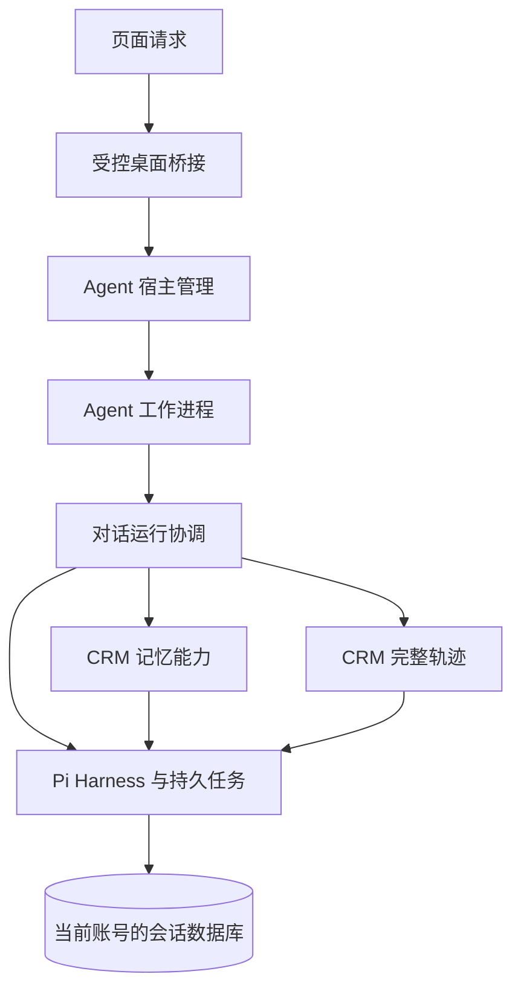
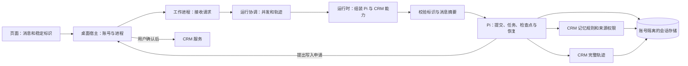

# Pi 1.4.0 生命周期、记忆和轨迹：核查记录

核查范围：本工作区 `client/package.json` 和锁文件所使用的 `@earendil-works/pi-durable`、`@earendil-works/chord`、`@earendil-works/pi-telemetry` 均为 1.4.0。本记录以本地安装包 README、声明和实际源码为准，并与 [Pi v1.4.0 官方文档](https://github.com/earendil-works/pi/blob/v1.4.0/packages/durable/README.md)相互核对。版本标签可访问；本次没有独立验证 npm 包与 Git 标签的二进制构建来源。官方将该包标为 experimental，接口可能随版本变化；有恢复功能和测试不等于已经证明所有生产故障都能恢复。

## Pi 本身负责什么

1. **会话与提交。** `Harness.open` 在一个存储之上打开会话；`root` 或 `createConversation` 创建/恢复对话；`submit` 把输入登记成 submission。会话条目、文档和任务可在一次 commit 中原子写入。[官方文档：概念](https://github.com/earendil-works/pi/blob/v1.4.0/packages/durable/README.md#concepts)；本地包 `client/node_modules/@earendil-works/pi-durable/README.md:73-102`。
2. **任务与恢复。** 内置模型生成、工具调用以及通过 `defineTask` 注册的应用任务，可在阶段结束时保存状态/检查点；重启后调用 `resume()`，或提交/等待时启动调度。相同 `requestId` 可找到原 submission。任务阶段中断后从该阶段的入口重新运行，外部副作用仍需要业务自己的幂等措施。[官方文档：恢复](https://github.com/earendil-works/pi/blob/v1.4.0/packages/durable/README.md#persist-and-resume)；本地 README:115-162。
3. **工具恢复不是无条件重放。** 工具在执行前记录意图；中途崩溃后，只有声明 `replay: "safe"` 的工具才会重跑。即使声明安全，外部写入仍须保证幂等；否则中断工具会返回 interrupted 结果。[官方文档：Tools](https://github.com/earendil-works/pi/blob/v1.4.0/packages/durable/README.md#tools)；本地 README:277, 328。
4. **停车、错误与关闭。** 默认连续 5 次无进展中断后任务停放，可用 `inspect()` 查看、`retryTask()` 再试；`onReport` 可向宿主报告任务、扩展和存储等错误。存储错误会使 Harness 自行关闭，可通过 `harness.closed` 区分正常关闭与失败。关闭会等待任务代码返回；不响应取消信号的代码可能延迟关闭。[官方文档：失败与恢复](https://github.com/earendil-works/pi/blob/v1.4.0/packages/durable/README.md#failures-and-recovery)、[Errors](https://github.com/earendil-works/pi/blob/v1.4.0/packages/durable/README.md#errors)；本地 README:214-220, 819-835；实现 `client/node_modules/@earendil-works/pi-durable/dist/harness/harness.js:112-146,179-216`。
5. **取消的范围。** `BACKGROUND_CONTEXT` 不会主动取消；取消一次 wait 只结束等待，不会自动停止工作。停止当前对话应评估 Pi 的 `conversation.abort`；排队提交和后台任务各有不同的停止语义。[官方文档：Abort and Subagents](https://github.com/earendil-works/pi/blob/v1.4.0/packages/durable/README.md#abort-and-subagents)；本地 README:78, 518, 636-676。
6. **扩展和观察点。** Pi 提供 GenerationTask 的 beforeRequest/afterResponse 等 hook，以及 ToolTask 的 beforeTool/afterTool。它们可以组织 CRM 的扩展；Pi 的任务机制不自动提供 CRM 的长期记忆策略、成员权限或人工审批。[官方文档：Hooks](https://github.com/earendil-works/pi/blob/v1.4.0/packages/durable/README.md#hooks)；本地 README:606-625。
7. **存储所有权。** 官方要求同一 Pi storage 一次只有一个进程持有，并声明无跨进程锁。Node SQLite 默认适配器使用 WAL、`synchronous=NORMAL`；其文档说明进程崩溃与整机断电的持久性边界不同。CRM 的加密数据库走 `encrypted-sqlite.mjs` 的 libSQL 适配器，不能仅凭 Node 默认适配器的设置推断其断电保证。[官方文档：Storage](https://github.com/earendil-works/pi/blob/v1.4.0/packages/durable/README.md#storage)；本地 README:759-790，`client/agent/encrypted-sqlite.mjs:11-29`。

## CRM 当前实际接入

- [agent-host.cjs](../client/electron/agent-host.cjs) 管理 Agent 工作进程的启动、就绪、停止和恢复。主进程仍负责账号、租户和 IPC 发送者校验；登录令牌不传给工作进程。同一个存储在旧进程退出前不会由新进程打开。
- [runtime.mjs](../client/agent/runtime.mjs) 负责组装 Pi Harness、扩展、模型、记忆任务和轨迹。它注册 `onReport` 并监听 `harness.closed`；发送给宿主的是白名单内的错误类别，不包含错误原文。
- [worker.mjs](../client/agent/worker.mjs) 正常启动时启用记忆。[turn-coordinator.mjs](../client/agent/memory/turn-coordinator.mjs) 先登记监听与待补查任务；语义索引创建时暂不启动调度。待会话、任务绑定、记忆监听和 Harness² 准备完毕后，运行时再调用 `resume()`。
- [memory/tasks.mjs](../client/agent/memory/tasks.mjs) 使用 Pi `defineTask`、检查点和 sleep；记忆协调器负责 CRM 的提取触发、去重及恢复扫描；[memory/repository.mjs](../client/agent/memory/repository.mjs) 管理记忆来源、权限、候选和版本等业务数据。这些业务规则不能由 Pi 的基础任务调度自动代替。
- [run-coordinator.mjs](../client/agent/run-coordinator.mjs) 管理工作进程已接收的请求、一次聊天的轨迹和关闭等待；[chat-requests.mjs](../client/agent/chat-requests.mjs) 把用户操作标识绑定到原对话和内容摘要，再使用 Pi 的 `requestId` 找回已有提交。[memory/facade.mjs](../client/agent/memory/facade.mjs) 集中记忆操作及来源复核；[trace-facade.mjs](../client/agent/trace-facade.mjs) 集中读取、重建和投递状态的协调。
- [evolution-task.mjs](../client/agent/evolution-task.mjs) 使用持久父任务，并用 `abandonOnRestart:true` 处理一次具体尝试；恢复后应用代码仍负责重新核验来源权限。没有为统一形式移除这项约束。
- 宿主当前没有提供 Pi `inspect/retryTask` 的完整交互入口。任务停放等类别会提示用户查看任务状态；这不代表所有 Pi 任务都有可操作的恢复界面。

## Pi 轨迹和 CRM 轨迹的区别

- Pi 的 `HarnessOptions.telemetry` 不传时为 no-op。标准 `pi.durable.submit` / `pi.durable.phase` 等记录任务、阶段、结果与关联标识；文档说明标准属性不含消息、工具参数或结果，故它不能直接取代 CRM 要求的完整模型输入、输出与工具调用记录。[Pi 遥测说明](https://github.com/earendil-works/pi/blob/v1.4.0/packages/durable/README.md#quick-start)；本地 README:78-90。
- [run-telemetry.mjs](../client/agent/run-telemetry.mjs) 通过 Pi hook 采集实际模型请求和响应、工具参数及结果；[trace-store.mjs](../client/agent/trace-store.mjs) 通过 Pi 文档保存详情与投递状态；[langfuse-export.cjs](../client/electron/langfuse-export.cjs) 转换成 Langfuse OTLP。历史重建由 [trace-history.mjs](../client/agent/trace-history.mjs) 处理，无法恢复的字段会标注不可用。
- `pi-telemetry` 定义遥测契约和内存实现，本身不提供 exporter。Chord 1.4.0 另有 `createSqliteTelemetry`，可缓冲并查询 SQLite 中的遥测；默认保留 7 天，每秒刷新，满队列会计数丢弃，写失败会停止记录，且它不持有/关闭数据库。[Pi Telemetry v1.4.0](https://github.com/earendil-works/pi/blob/v1.4.0/packages/telemetry/README.md)、[Chord SQLite telemetry v1.4.0](https://github.com/earendil-works/pi/blob/v1.4.0/packages/chord/README.md#sqlite-telemetry)；本地 Chord README:95-121。
- 若探索 Pi 标准遥测，应先明确它是补充的诊断数据还是拟替代哪些字段，并核验数据库队列、加密、保留期、丢弃计数、关闭顺序和导出权限。不能认为接入适配器即获得 Langfuse 导出或现有 CRM 完整轨迹。

## 最初确认的问题（重构前）

1. `runtime.mjs` 的 `chat` 先设置 `currentQuery`，再保存对话标题；清除状态的 `finally` 从标题保存之后才开始。纯内存故障注入让标题保存抛错后，下一次 `newConversation()` 返回 `BUSY`。这是模拟应用层异常的结果，不代表已经复现真实磁盘故障。[runtime.mjs](../client/agent/runtime.mjs):63；[conversations.mjs](../client/agent/conversations.mjs):42-44。
2. 工作进程在检查临时模式前就打开 `runs.jsonl`。临时模式的对话和完整轨迹使用内存数据库，但该文件仍记录运行编号、时间、状态等元数据。用隔离临时目录启动、关闭并重启真实 worker 后，仍能通过 `traces` 读到原状态。该文件按当前实现不记录对话正文、工具参数或模型密钥；这个结果不证明其他存储和导出路径均没有数据。[worker.mjs](../client/agent/worker.mjs):13-15；[trace.mjs](../client/agent/trace.mjs):5-13；[SettingsPanel.tsx](../client/src/SettingsPanel.tsx):21。
3. Electron 主进程收到工作进程退出事件时只清除 `agent` 引用，下一次请求才尝试启动；它不持有 Pi 的 Harness。Pi 存储失败而 worker 仍存活时，当前源码没有使用 `harness.closed` 通知主进程，可能继续向已关闭的 Harness 发请求；这条故障链尚需注入真实存储故障验证。[main.cjs](../client/electron/main.cjs):58-102；[runtime.mjs](../client/agent/runtime.mjs):49-50。
4. 应用层有多处与一次对话有关的状态：worker 的 `chatInProgress`、`activeDetail`，运行时的 `currentQuery`、`currentRun`，以及 Pi 自己的任务状态。它们用途不完全相同，但当前跨文件协调，失败和关闭顺序需要同时检查。[worker.mjs](../client/agent/worker.mjs):5-10；[runtime.mjs](../client/agent/runtime.mjs):32-35,63。
5. 项目安装的 Electron 43.8.4 在本机自带 Node 24.22.1，满足 Pi 包声明的 Node >=22.19.0；这只验证了安装的 Electron 可执行文件，未验证最终打包程序。

## 原方案：保留 Pi 内核，整理 CRM 宿主

以下四阶段保留为实施前方案；当前状态和边界见后面的实施记录。

### 第一阶段：修复可复现问题

- 将对话标题保存、轨迹开始及 Pi 提交统一纳入 `try/finally`，任何异常都清理运行状态。保留当前一次只允许一个对话操作的行为，并验证失败后仍可新建或切换对话。
- 为临时模式使用只在内存中的运行状态记录；持久模式继续使用原有文件。不要自动删除已有历史文件。分别验证退出、重新打开和模式切换后，临时记录不会出现在历史状态列表中。

### 第二阶段：明确宿主和 Pi 的职责

- 可从 `main.cjs` 抽出一个宿主管理模块，集中管理工作进程启动、就绪、请求、停止和退出通知。主进程继续校验 IPC 发送者及当前账号；不得向 worker 传递登录令牌。
- 宿主管理模块应保留现有 `generation` 校验、停止旧进程后再打开相同数据库的约束，以及停止/启动超时。内部状态可明确为停止、启动中、就绪、停止中、失败，避免多处各自推断。
- worker 在创建 Harness 后监听 `harness.closed`，并通过 `onReport` 汇报可分类的失败；发生失败时通知宿主，宿主先等待旧 worker 退出，再按当前账号状态决定是否重开。建议仅对可重试故障设置有上限的退避，例如 1、2、4 秒共 3 次；密钥错误和持续存储错误转为可见失败。实际阈值需在实现时配置和测试。
- 退出、切换账号、切换隐私模式后不得继续重启旧 worker。若重启后模型密钥丢失，应提示重新配置；临时模式的内存对话无法恢复。诊断信息也可能包含调用方内容，报告时需限制和清理。

### 第三阶段：整理运行时组装和关闭顺序

- 保留 Pi 的 `Harness`、任务、检查点、`resume`、`close` 和中断规则。`runtime.mjs` 可以继续承担组装入口，但把一次对话的忙碌状态、当前运行编号和轨迹收集的协调收拢到一个对话运行模块，避免由 worker 和运行时各自管理完整流程。它必须保留当前的并发拒绝、对话切换限制和审批关联行为。
- 初始化失败时按资源的实际所有权释放已创建资源；Harness 接管 storage 后避免重复关闭。关闭时停止接收新工作，协调正在执行的对话和轨迹写入，停止记忆监听，再关闭 Harness；对不响应取消的任务保留有界超时和进程退出兜底。强制退出时只能恢复已提交的数据，不能承诺内存中的完整轨迹一定保留。
- 统一审查恢复入口，保证所需扩展、任务绑定和业务监听已准备好。重构前开启语义索引时，`semanticIndex.ensure()` 可能在记忆协调器创建前调用 `harness.resume()`；不要只移动单个 resume 调用，应为该顺序补充恢复测试。[runtime.mjs](../client/agent/runtime.mjs):47-59；[semantic-index.mjs](../client/agent/memory/semantic-index.mjs):37-42。
- 超时只代表宿主停止等待，不代表 Pi 中的工作已经取消；是否调用 Pi 的对话 abort 或任务 abort 必须按用户意图和任务类型决定。可以评估用稳定 `requestId` 关联同一次重连或重试，但必须在 UI、宿主、worker 和 Pi 之间贯通，并维持 CRM 写入的人工审批及幂等，不把重新发送当作自动安全。

### 第四阶段：保留业务记忆和完整轨迹，按需优化

- 继续用 Pi 承载 CRM 的记忆任务和检查点；来源权限、记忆冲突、人工确认、召回及索引仍属于 CRM 业务。`turn-coordinator.mjs` 已经独立，先收敛它与运行时之间的接口，不增加只转发的模块。Pi 1.4.0 文档未提供新版文档中的 `afterRun`；不能假设当前版本已经支持该 hook。
- 目前协调器处理每次完成的对话时会扫描已完成的提交和相关历史条目。先测量长对话的时间及内存；若证明有瓶颈，再设计增量游标和缓存，并保证初次激活、历史补扫、权限撤销、任务去重和阈值计算语义一致。
- 保留现有 Pi hook 采集的完整模型与工具内容、Pi 文档中的轨迹和 Langfuse 导出。若需要补充 Pi 原生 telemetry，应将其作为任务阶段和错误的诊断来源，先核对适配器、缓冲、丢弃、保留和关闭顺序，不能用它直接替换完整轨迹。

## 实施记录

- **Pi 内核保留。** 没有自建替代 Pi 的任务调度、检查点或恢复系统。Pi 管理提交和任务；CRM 管理桌面进程、账号、记忆规则、审批与完整轨迹。
- **启动与恢复。** [agent-host.cjs](../client/electron/agent-host.cjs) 集中管理进程。持久会话在工作进程就绪后的异常退出或运行时存储故障时，旧进程退出后按 1、2、4 秒最多自动恢复三次；恢复后稳定 60 秒才清空连续失败计数。临时会话异常退出不自动恢复。启动超时为 20 秒，停止时 10 秒尝试强制结束，等待旧进程退出最多 15 秒。启动阶段的失败直接报告，不保证自动重试。
- **资源归属和顺序。** 初始化失败会关闭已接管的 Harness 或 storage；它们尚未接管时关闭数据库。正常关闭先停止接收工作，等待已接收请求和已排队轨迹，再关闭记忆协调器和 Pi Harness。工作进程中断或被强制结束时，只能依赖已提交的数据恢复；Pi 关闭期间产生的辅助轨迹仍可能无法写入已关闭的存储。
- **临时会话。** 对话、完整轨迹及运行状态保存在内存。临时模式不会读取、写入或删除已有的持久 `runs.jsonl`。
- **同一消息的续接。** 页面为一次发送生成稳定 `requestId`；工作进程中正在处理的同一请求共享结果，Pi 已收到时会续接原提交。CRM 另存请求标识对应的对话和消息摘要，拒绝用相同标识换内容或对话。重连已有提交不会再创建一条完整轨迹；历史不完整时仍按既有历史重建规则标记缺失。用户选择“停止等待”不会取消 Pi 任务；随后主动发起新消息会使用新标识，不能将其视为原请求的续接。页面中的待续接标识只保留在当前页面内，应用完全退出后不会自动恢复该操作入口。
- **审批不变。** Agent 对 CRM 写入仍只能提出申请；用户确认及原有业务幂等规则继续生效。稳定的对话请求标识不等于所有外部副作用都能自动安全重放。

### 实施后的数据流

### 长对话的隔离测量

本机 Node 24.14.1，调用实际记忆协调器及快照构造逻辑，使用内存数组模拟历史和空实现模拟存储、权限、任务；每轮两条文本，没有工具调用。每个规模各运行 7 次。内存值是处理前强制垃圾回收后，到处理结束时的堆使用增量中位数，并非峰值内存。

| 历史对话轮数 | 条目数 | 单次处理中位时间 | 堆增量中位数 |
| ---: | ---: | ---: | ---: |
| 100 | 200 | 0.17 毫秒 | 0.27 MiB |
| 1,000 | 2,000 | 0.58 毫秒 | 2.36 MiB |
| 5,000 | 10,000 | 2.48 毫秒 | 11.76 MiB |

这只说明合成数据下扫描会随历史增长，未包含真实 SQLite、权限查询、模型、网络、工具记录及生产数据。暂不引入增量游标，以免在没有瓶颈证据时改变首次激活、补扫、权限撤销、去重和阈值规则；生产规模应再测后决定。

## 方案验收条件

- 标题保存失败后状态释放；同一对话并发请求仍按现有规则拒绝；超时重连不会重复提交同一输入。
- 发生可恢复存储故障或 worker 异常退出时，旧进程退出后才启动新进程；连续失败停止重试并展示原因；账号切换后旧结果不能进入新账号。
- 临时模式重启后不保留对话、完整轨迹或本次运行状态；持久模式历史仍可恢复，已有文件不被清理。
- 在语义索引已启用、模型密钥暂不可用、任务执行中被终止以及来源权限撤销等场景下，保持 Pi 任务恢复、人工审批、来源复核和幂等规则。
- 验证主动关闭、崩溃、等待超时及轨迹写入中的关闭；区分完整轨迹、历史重建和已中断记录，不把无法恢复的内容标为完整。

## 验证边界

本次完整客户端测试通过：页面 17 项、Electron 109 项、Agent 130 项；客户端构建通过。自动测试覆盖了标题保存失败、真正重叠的并发、临时会话、Pi 存储故障、旧进程退出顺序、账号切换、语义索引启动顺序、记忆崩溃恢复、同一请求续接和轨迹去重。测试使用受控模拟模型以及部分真实 Pi/SQLite 与工作进程；不等于验证了所有崩溃时序。

没有实际点击桌面界面，没有连接真实模型或真实网络，也没有验证最终打包程序。模型密钥仍只保存在工作进程内，异常恢复后需要重新配置。Pi 自动恢复任务时如果模型密钥尚未配置，任务的后续表现仍取决于具体任务和 Pi 的失败规则；不能承诺全部任务都会等待密钥后成功恢复。
